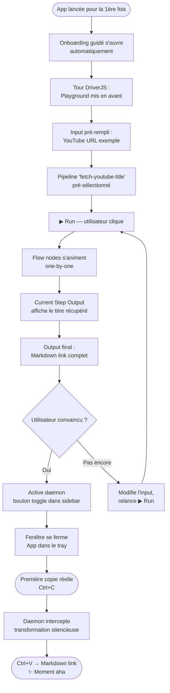
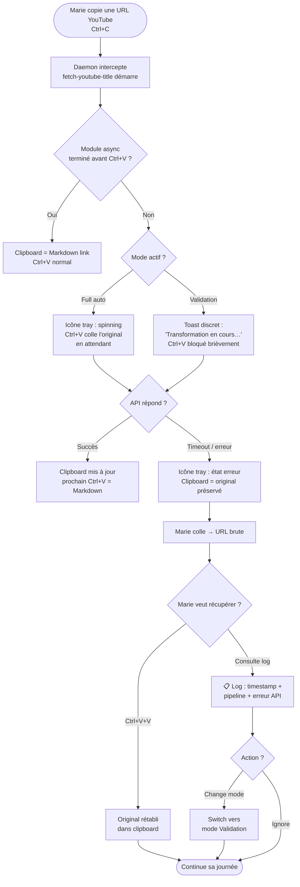

# UX Design Specification UltraClipboard

**Author:** Grochonnou
**Date:** 2026-03-07

---

## Executive Summary

### Project Vision

UltraClipboard est une application desktop native (Tauri + Svelte) qui automatise les transformations de texte répétitives au niveau du clipboard. Elle intercepte le contenu copié, applique des pipelines de transformation composés de modules JavaScript réutilisables, et délivre le résultat prêt à coller — silencieusement, dans le geste Ctrl+C / Ctrl+V existant. Aucune nouvelle habitude. Aucun changement de contexte.

L'UI principale est un **playground** — environnement de test visuel où l'utilisateur voit sa string transformée étape par étape avant d'activer le daemon. Le daemon background est le second mode du même moteur d'exécution. L'invisibilité est le critère de succès ultime : l'outil disparaît dans le workflow de l'utilisateur.

### Target Users

| Persona | Contexte | Pain Point | Moment de succès |
|---|---|---|---|
| **Marie** — rédactrice/PKM | Obsidian, prise de notes, vidéos | 4–5 étapes manuelles pour chaque lien YouTube | Copier une URL et coller un lien Markdown sans y penser |
| **Thomas** — contrôleur de gestion | ERP → Excel, formats incompatibles | Reformatage manuel de nombres à chaque collage | Les nombres collent correctement sans aucune intervention |
| **Alex** — développeur (secondaire) | Contributeur à l'écosystème | Besoin d'un contrat de module simple et d'un canal de distribution | Publier un module en 20 min, voir d'autres l'utiliser |

Marie et Thomas ne sont pas techniques. Leur rapport à l'outil passe intégralement par le playground et le système tray — jamais directement par le YAML de configuration.

### Key Design Challenges

1. **Concevoir l'invisible** — Le succès de l'app se mesure à ce que l'utilisateur l'oublie. Comment onboarder et construire la confiance envers quelque chose conçu pour disparaître ?
2. **Confiance et contrôle pour les non-techniques** — Marie et Thomas doivent pouvoir comprendre ce que fait un pipeline, et savoir pourquoi ça marche ou échoue, sans lire de YAML ni de code.
3. **Communication d'état async non-intrusive** — Quand un module async (ex. `fetch-youtube-title`) est en cours au moment du Ctrl+V, l'app doit communiquer un état sans bloquer l'utilisateur ni générer d'anxiété.

### Design Opportunities

1. **Le playground comme outil de confiance** — Le step debugger transforme une boîte noire en processus transparent. C'est l'élément qui convertit les sceptiques et permet l'adoption.
2. **Le system tray comme "gardien silencieux"** — Une icône minimaliste à 3 états (idle / processing / error) peut être très expressive si bien conçue — présence rassurante, jamais intrusive.
3. **Orchestrer le moment "aha"** — Tout l'onboarding converge vers ce premier collage magique où la transformation s'est faite sans que l'utilisateur y pense. C'est un parcours émotionnel à designer intentionnellement.

---

## Core User Experience

### Defining Experience

L'expérience cœur d'UltraClipboard se résume à un seul geste : **Ctrl+C → [transformation invisible] → Ctrl+V**. L'utilisateur ne fait rien de nouveau — l'application s'insère dans le workflow existant sans en modifier la mécanique. La valeur est entièrement dans ce qui se passe entre les deux touches.

Le playground est le second mode de la même expérience : une fenêtre de confiance où l'utilisateur peut observer, tester, et comprendre les transformations avant de les confier au daemon. Ce n'est pas une interface d'administration — c'est un environnement de découverte et de validation.

### Platform Strategy

- **Desktop natif exclusivement** (Windows, macOS, Linux via Tauri + Svelte)
- **Souris + clavier uniquement** — aucune considération tactile
- **Offline par défaut** — les modules locaux fonctionnent sans réseau ; les modules async (ex. `fetch-youtube-title`) requièrent une connexion et doivent gérer l'absence de réseau gracieusement
- **System tray** comme point de présence permanent et discret ; **playground** comme fenêtre occasionnelle ouverte à la demande
- Aucun auto-update MVP — distribution via GitHub Releases uniquement

### Effortless Interactions

Ce qui doit demander **zéro effort** :

- **Le geste Ctrl+C / Ctrl+V** — aucune friction ajoutée, aucun délai perceptible pour les modules synchrones
- **Le rappel de l'original (Ctrl+V+V)** — le filet de sécurité doit être aussi instinctif que le geste d'origine
- **La compréhension du résultat dans le playground** — l'utilisateur voit la transformation, pas du code

Ce qui est **délibérément non-effortless** (et c'est correct) :

- La configuration YAML des pipelines — destinée à des profils techniques (Alex, ou le collègue dev de Thomas), pas aux utilisateurs finaux directs

### Critical Success Moments

1. **Playground live pendant l'onboarding** — Marie entre une URL YouTube et voit apparaître un lien Markdown formaté. Ce moment décide si elle adopte ou désinstalle. C'est le seuil de confiance initial.
2. **Premier collage automatique** — Le moment "aha" : la transformation a eu lieu sans y penser. C'est le critère de succès ultime et le point de bascule vers l'adoption durable.
3. **Récupération d'erreur sans stress** — Ctrl+V+V fonctionne, le log indique ce qui s'est passé. L'utilisateur reste en confiance même quand un module échoue. L'erreur ne détruit pas le workflow.

### Experience Principles

1. **"Zero new gesture"** — Chaque interaction UX s'appuie sur des gestes que l'utilisateur connaît déjà. On n'invente aucune nouvelle mécanique d'interaction.
2. **"Transparency builds trust"** — Le step debugger du playground est le contrat de confiance. L'utilisateur ne doit jamais se demander "qu'est-ce qui s'est passé ?" — la réponse doit être accessible sans effort.
3. **"Quiet presence"** — Le system tray est toujours là, mais ne demande jamais d'attention. L'app s'exprime uniquement quand c'est nécessaire, via des signaux visuels discrets.
4. **"Failure is recoverable"** — Chaque point d'échec dispose d'un filet de sécurité visible et simple. L'erreur est de l'information, pas une catastrophe.

---

## Desired Emotional Response

### Primary Emotional Goals

L'objectif émotionnel primaire d'UltraClipboard est la **calme confiance** : l'utilisateur sait que l'outil est là, qu'il fait son travail, et n'a pas besoin d'y penser. Ce n'est pas l'excitation (trop active pour un daemon silencieux) ni la surprise (déstabilisante en contexte professionnel). C'est la forme la plus haute de satisfaction pour un outil de productivité invisible : la loyauté tranquille d'un outil qu'on remarquerait uniquement s'il disparaissait.

### Emotional Journey Mapping

| Étape | Émotion cible | Émotion à éviter |
|---|---|---|
| Découverte | Curiosité, légère incrédulité | Scepticisme paralysant |
| Onboarding playground | Surprise constructive, confiance qui monte | Confusion, sentiment d'être perdu |
| Premier collage automatique (aha) | Légère surprise, puis soulagement | Méfiance ("est-ce que ça a vraiment changé ?") |
| Usage quotidien | Productivité invisible, calme | Conscience de l'outil (si l'utilisateur y pense, on a échoué) |
| État d'erreur | Réassurance ("j'ai l'original, je suis en sécurité") | Anxiété, sentiment de perte |
| Usage long terme | Loyauté tranquille — "je le remarquerais s'il n'était plus là" | Indifférence |

### Micro-Emotions

- **Confiance** (pas scepticisme) — construite par le step debugger : l'utilisateur voit, donc il croit
- **Calme** (pas anxiété) — même en cas d'erreur, le système montre qu'il a préservé l'original
- **Compétence** (pas frustration) — savoir qu'on peut récupérer redonne le contrôle
- **Appartenance discrète** — être parmi les utilisateurs qui ont automatisé ce que les autres font encore à la main

**Émotions à éviter absolument :**

- Anxiété sur "est-ce que ma copie a bien fonctionné ?"
- Frustration quand une transformation échoue (→ remplacée par réassurance via Ctrl+V+V)
- Sentiment d'intrusion ("l'app a modifié mon clipboard sans me demander")
- Overwhelm face à la configuration YAML

### Design Implications

| Émotion cible | Choix UX associé |
|---|---|
| Confiance | Step debugger visible, log accessible, mode validation disponible |
| Calme | System tray discret, pas de notifications push, états visuels subtils |
| Compétence | Ctrl+V+V instinctif, log clair, fallback automatique |
| Appartenance | Convention `ultraclipboard-module-*` lisible, playground partageable |
| Réassurance | Icône d'erreur discrète (pas rouge agressive) ; log informatif sur l'outcome, pas alarmiste |

### Emotional Design Principles

1. **"Invisible success"** — Le summum de la réussite émotionnelle est quand l'utilisateur ne pense plus à l'outil. L'absence de friction *est* le sentiment.
2. **"Trust through transparency"** — La confiance se construit par la visibilité (step debugger, log) pas par des garanties verbales. Montrer, pas promettre.
3. **"Safe failure"** — Chaque état d'erreur doit déclencher réassurance plutôt qu'anxiété. L'utilisateur est toujours en sécurité parce qu'il a toujours l'original.
4. **"Quiet belonging"** — Les utilisateurs qui adoptent UltraClipboard font partie d'un groupe discret de gens qui ont résolu un problème que la plupart subissent sans le nommer.

---

## UX Pattern Analysis & Inspiration

### Inspiring Products Analysis

**Obsidian — "La complexité rendue navigable"**

Ce qui fonctionne bien du point de vue UX :
- Écosystème de plugins avec convention communautaire (GitHub → browse → install) — modèle adopté directement par UltraClipboard avec `ultraclipboard-module-*`
- Prévisualisation live dans l'éditeur (Markdown rendu en temps réel) — pattern directement transférable au step debugger : l'utilisateur voit la transformation pendant qu'il la configure
- Philosophie "fichiers locaux comme source de vérité" — pas de cloud, pas de dépendance, pas d'anxiété sur la confidentialité des données

Points de friction à éviter :
- App vide au premier lancement qui overwhelme les nouveaux utilisateurs (trop de liberté d'un coup)
- Découverte de plugins difficile si on ne sait pas ce qui existe

**Password Managers — "L'invisible qui soulage"**

Modèle le plus proche d'UltraClipboard philosophiquement. Ce qui fonctionne :
- L'autofill est fonctionnellement identique au full-auto mode — le gestionnaire détecte le contexte et agit sans être demandé. Le premier autofill réussi génère exactement le même "aha" qu'UltraClipboard cherche à créer
- Icône d'extension à états contextuels (a des identifiants / n'en a pas / bloqué) — modèle direct pour le system tray idle / processing / error
- Le coffre-fort comme filet de sécurité — fiabilité constante qui construit la confiance qui permet l'oubli — équivalent du Ctrl+V+V et du traceability log

Points de friction à éviter :
- Autofill dans le mauvais champ → risque d'un trigger `content_regex` trop large qui transforme à tort
- Demande d'authentification au mauvais moment → friction qui brise l'invisibilité

**Espanso — "Le daemon YAML communautaire"**

Ce qui fonctionne :
- YAML comme langage de configuration respecté (pas caché derrière une UI simplifiée) — les power users apprécient la transparence du format
- GitHub comme canal de distribution de packages — modèle identique à `ultraclipboard-module-*`
- Daemon background léger avec empreinte minimale

Ce qu'UltraClipboard améliore par rapport à Espanso :
- Espanso n'a pas de playground — aucun moyen de tester une expansion en temps réel avant de la déployer → avantage différenciateur majeur d'UltraClipboard
- Les erreurs YAML échouent silencieusement chez Espanso → le traceability log et le step debugger résolvent ce problème directement

### Transferable UX Patterns

**Patterns de navigation :**
- **Icône à états contextuels** (password managers) — une icône tray qui change visuellement selon l'état (idle / processing / error) sans popup ni notification aggressive
- **Convention de découverte communautaire** (Obsidian, Espanso) — GitHub comme store, les stars comme curation, les forks comme contribution

**Patterns d'interaction :**
- **"Detect & act" automatique** (password managers / autofill) — même modèle mental que le full-auto mode : l'outil détecte le contexte et agit, l'utilisateur récupère le bénéfice sans geste supplémentaire
- **Live preview step-by-step** (Obsidian editor) — voir le résultat en temps réel pendant la configuration, pas après

**Patterns visuels :**
- **Présence minimale permanente** (password managers) — toujours là, jamais envahissant ; s'exprime uniquement au moment utile
- **Transparence de configuration** (Espanso) — YAML visible et éditable directement, pas caché derrière des abstractions

### Anti-Patterns to Avoid

- **App vide au premier lancement** (Obsidian) — UltraClipboard démarre avec un pipeline préconfiguré fonctionnel, pas une page blanche
- **Déclenchement dans le mauvais contexte** (password managers autofill) — les triggers `content_regex` trop larges trahissent la confiance ; l'onboarding doit sensibiliser à la précision des triggers
- **Échec silencieux du YAML** (Espanso) — toute erreur de configuration ou d'exécution doit être observable dans le log, jamais silencieuse
- **Friction d'authentification intempestive** (password managers) — aucune confirmation demandée en mode full-auto ; la demande de confirmation (mode validation) est un choix explicite de l'utilisateur, pas un comportement par défaut

### Design Inspiration Strategy

**À adopter directement :**
- Modèle "detect & act" des password managers → full-auto mode sans friction
- Icône tray à états contextuels → idle / processing / error discrets
- Convention communautaire GitHub → `ultraclipboard-module-*` comme écosystème

**À adapter :**
- Onboarding Obsidian → moins de liberté initiale, un pipeline concret préconfiguré comme point d'entrée (pas une page blanche)
- YAML d'Espanso → conserver la transparence du format mais rendre les erreurs observables via le log

**À éviter :**
- Toute transformation silencieuse non observable (anti-Espanso) → le log est non-négociable
- Triggers trop larges qui créent de la méfiance (anti-password-manager-autofill-raté)
- Premier lancement sans guidance concrète (anti-Obsidian-blank-state)

---

## Design System Foundation

### Design System Choice

**Shadcn-svelte** — port Svelte de shadcn/ui, avec modèle copy-paste (composants intégrés directement dans le codebase, sans dépendance runtime).

### Rationale for Selection

- **Neutralité visuelle** — le design sobre de shadcn correspond à l'esthétique "outil discret" recherchée ; aucun style à déshabiller pour atteindre la sobriété voulue
- **Modèle copy-paste** — les composants sont copiés dans le projet et en deviennent propriétés ; pas de dépendance externe runtime, ce qui évite les problèmes de compatibilité dans un contexte Tauri
- **Surface UI réduite** — pour un MVP avec 5–8 composants nécessaires (Button, Input, Select, Card, Badge, Dialog, Tabs), shadcn-svelte couvre parfaitement le périmètre sans surcharge
- **Theming par CSS variables** — personnalisation de l'identité visuelle sans modifier les composants eux-mêmes
- **Projet solo** — pas de courbe d'apprentissage en équipe, documentation solide, communauté active

### Implementation Approach

Intégration directe via CLI shadcn-svelte (`npx shadcn-svelte@latest init`) dans le projet Svelte. Composants ajoutés à la demande selon les besoins de chaque écran, plutôt qu'une installation globale. Theming configuré dès le départ via les CSS variables pour assurer la cohérence visuelle.

### Customization Strategy

- Palette de couleurs définie via tokens CSS (mode clair + mode sombre natif)
- Aucune modification des composants shadcn eux-mêmes — personnalisation via les variables uniquement, pour garder la compatibilité avec les futures mises à jour
- Composants custom créés au-dessus de la fondation shadcn uniquement si un besoin spécifique ne peut pas être couvert (ex. step debugger du pipeline, system tray status indicator)

---

## Core User Experience

### Defining Experience

UltraClipboard possède deux expériences définissantes complémentaires :

**Expérience 1 — Le playground : "Je vois la magie avant de lui faire confiance"**

L'utilisateur entre un texte, sélectionne un pipeline, et voit apparaître le résultat transformé — avec la string intermédiaire visible à chaque étape du pipeline. C'est le moment de conversion : le playground permet de croire avant de déléguer. Le workflow naturel est playground d'abord (comprendre) → daemon ensuite (déléguer).

**Expérience 2 — Le daemon : "Ça a marché sans que j'y pense"**

L'utilisateur copie comme d'habitude, colle comme d'habitude, et réalise que le contenu est déjà exactement ce dont il avait besoin. Le premier collage automatique est le point de non-retour — le moment de fidélisation.

### User Mental Model

Avant UltraClipboard : le clipboard est un buffer passif — ce que je copie = ce que je colle.

Après UltraClipboard : le clipboard est un pipeline — ce que je copie entre dans un processus, ce que je colle est le résultat. Ce changement de modèle mental doit être enseigné progressivement via le playground, pas imposé par le daemon dès le premier lancement.

### Success Criteria

- L'utilisateur comprend ce que fait un pipeline **en le voyant**, pas en lisant de la documentation
- Le premier collage automatique se produit **sans action supplémentaire** de l'utilisateur
- En cas d'erreur, l'utilisateur retrouve son contenu original **sans effort**
- L'utilisateur peut **décrire à un ami** ce que fait l'app en une phrase

### Novel UX Patterns

Le copy-paste est le pattern le plus établi de l'informatique desktop. UltraClipboard ne le remplace pas — il s'y greffe. L'innovation est dans l'interception invisible, pas dans le geste.

La seule mécanique réellement nouvelle : **Ctrl+V+V** pour rappeler l'original. Ce pattern est proche de "Ctrl+Z étendu" — suffisamment familier pour être compris instinctivement, sans apprentissage explicite.

### Experience Mechanics

**Playground :**

| Phase | Ce qui se passe |
|---|---|
| Initiation | Clic sur l'icône tray → playground s'ouvre ; ou premier lancement avec onboarding guidé |
| Interaction | Texte saisi dans le champ input → pipeline sélectionné → exécution |
| Feedback | Chaque module affiche sa sortie intermédiaire dans le step debugger ; output final visible |
| Complétion | Utilisateur satisfait → active le pipeline en daemon, ou copie l'output manuellement |

**Daemon full-auto :**

| Phase | Ce qui se passe |
|---|---|
| Initiation | Ctrl+C (geste existant, aucun trigger nouveau) |
| Interaction | Système évalue les triggers → pipeline correspondant s'exécute → clipboard remplacé |
| Feedback | Icône tray passe brièvement en "processing" pour les modules async, puis retour idle |
| Complétion | Ctrl+V → contenu transformé collé. L'utilisateur voit le résultat, pas le processus |

**Récupération (Ctrl+V+V) :**

| Phase | Ce qui se passe |
|---|---|
| Initiation | L'utilisateur réalise que la transformation n'est pas ce qu'il voulait |
| Interaction | Ctrl+V+V → système restaure le contenu original du dernier Ctrl+C |
| Feedback | L'original est collé ; le log enregistre l'événement |
| Complétion | L'utilisateur est en sécurité, il a récupéré son contenu sans friction |

---

## Visual Design Foundation

### Color System

**Direction : Slate Dark** — fonds bleu-gris profonds, tons froids, accent indigo.

Palette de base (point de départ, à affiner sur tweakcn.com) :

| Token | Valeur de départ | Usage |
|---|---|---|
| `--background` | `#0f172a` | Fond principal |
| `--card` | `#1e293b` | Surfaces / panels |
| `--border` | `#334155` | Bordures |
| `--foreground` | `#f1f5f9` | Texte principal |
| `--muted-foreground` | `#94a3b8` | Texte secondaire |
| `--primary` | `#6366f1` | Accent indigo (CTA, focus) |
| `--success` | `#10b981` | État ok / pipeline réussi |
| `--destructive` | `#f43f5e` | État erreur |

**Note de contraste :** les ratios texte/fond doivent atteindre WCAG AA minimum (4.5:1 pour le texte courant). tweakcn.com permet d'ajuster les tokens en temps réel et d'exporter directement vers shadcn-svelte.

**Mode sombre uniquement pour le MVP** — mode clair hors scope.

### Typography System

- **Police système** en priorité (`-apple-system`, `BlinkMacSystemFont`, `Segoe UI`, `system-ui`) — natif, léger, zéro dépendance, cohérent avec l'esthétique outil
- **Police monospace** pour les valeurs du step debugger et les contenus clipboard (`SF Mono`, `Fira Code`, `Cascadia Code`, fallback `monospace`)
- **Hiérarchie minimale** : titre de section, label de champ, valeur, texte d'état
- **Taille de base : 14px** — compact, densité outil

### Spacing & Layout Foundation

- **Base unit : 4px** — échelle `4 / 8 / 12 / 16 / 24 / 32`
- **Densité : compacte** — outil, pas un site marketing ; padding réduit, peu d'espaces vides
- **Layout playground** : colonne unique, sections empilées verticalement (input → pipeline selector → run → step debugger → output)
- **Pas de grid complexe pour le MVP** — une seule fenêtre, layout linéaire

### Accessibility Considerations

- Contraste texte/fond : WCAG AA minimum (ratio 4.5:1) — à valider avec tweakcn.com lors de l'ajustement des tokens
- Les 3 états du tray (idle / processing / error) ne reposent pas uniquement sur la couleur — forme ou icône différente en complément
- Taille minimale des cibles interactives : 32px height

---

## Design Direction Decision

### Design Directions Explored

6 directions explorées : Linear (top-down classique), Split Panel (input/debugger côte à côte), Pipeline Flow (étapes comme nœuds visuels connectés), Terminal (monospace dense, dev-first), Sidebar Nav (navigation persistante multi-sections), Compact Dashboard (dense avec métriques intégrées).

### Chosen Direction

**Hybride : Sidebar Nav + Pipeline Flow current step output**

- **Structure globale** : Sidebar Navigation persistante à gauche (Playground / Pipelines / Modules / Log / Settings)
- **Vue Playground** : champ input + pipeline selector + bouton Run, suivi des étapes du pipeline affichées comme nœuds connectés horizontalement (Pipeline Flow), avec un panneau "Current Step Output" en dessous affichant la sortie de l'étape sélectionnée ou courante

```
┌─────────────┬──────────────────────────────────────┐
│ ⚡ Playground │  Input + Pipeline selector + Run      │
│ ⊞ Pipelines  │  ─────────────────────────────────── │
│ 📦 Modules   │  [input] ──▶ [fetch-title] ──▶ [out] │
│ 📋 Log       │  ─────────────────────────────────── │
│ ⚙ Settings  │  Current step output :               │
│             │  "Never Gonna Give You Up"            │
└─────────────┴──────────────────────────────────────┘
```

### Design Rationale

- **Sidebar** : anticipe naturellement la croissance des sections sans les cacher dans des onglets ou menus. Donne un sens de structure à l'app sans surcharger la vue active.
- **Pipeline Flow nodes** : rend visuels l'ordre et la progression des étapes — le step debugger devient une timeline qu'on peut inspecter, pas une liste de texte. Cohérent avec le principe "transparency builds trust".
- **Current Step Output** : permet de cliquer sur n'importe quel nœud du pipeline pour voir sa sortie, sans scroll ni recherche. Rend le débogage intuitif pour Marie comme pour Alex.
- La combinaison maintient la densité compacte de l'outil tout en rendant la mécanique du pipeline visible et inspectable.

### Implementation Approach

- Sidebar : composant fixe, largeur ~120–140px, navigation par icône + label court ; peut se réduire à icônes seules si la fenêtre est trop petite
- Pipeline flow nodes : composants `FlowNode` custom au-dessus de shadcn-svelte (shadcn ne fournit pas de composant flow natif)
- Current step output : panel sous les nœuds, mise à jour au clic sur un nœud ou en live pendant l'exécution
- Interaction : clic sur un nœud = sélection + affichage de sa sortie dans le panneau inférieur

---

## User Journey Flows

### Journey 1 — Marie : Premier lancement → Moment "aha"



### Journey 2 — Thomas : Module externe + configuration YAML

```mermaid
flowchart TD
    A([Thomas installe l'app]) --> B[Ouvre la section\n📦 Modules via sidebar]
    B --> C[Lit les instructions\nd'installation manuelle]
    C --> D[Clone / télécharge\nultraclipboard-module-normalize-number\ndepuis GitHub]
    D --> E[Module apparaît\ndans la liste Modules]
    E --> F[Va dans ⚡ Playground]
    F --> G[Saisit '1.234.567,89'\ndans Input]
    G --> H[Sélectionne pipeline\n'normalize-number']
    H --> I[▶ Run]
    I --> J[Flow nodes : input → normalize]
    J --> K[Current Step Output :\n'1234567.89']
    K --> L{Résultat correct ?}
    L -->|Non| M[Ajuste config du module\ndans l'éditeur YAML]
    M --> I
    L -->|Oui| N[Va dans ⊞ Pipelines]
    N --> O[Configure trigger\ncontent_regex: ^\d[\d.,]+$]
    O --> P[Active daemon]
    P --> Q([Lundi matin :\ncopie valeur ERP\ncolle dans Excel → format correct])
```

### Journey 3 — Marie : Erreur async + récupération



### Journey Patterns

- **Entry pattern** : toujours via sidebar (section active mise en avant au premier lancement = Playground) — pas de modal, pas de wizard séparé
- **Test-before-commit** : playground comme étape obligatoire avant activation daemon — jamais de daemon actif sans test préalable possible
- **Error = information** : chaque état d'erreur déclenche log + préservation de l'original, jamais une perte de données

### Flow Optimization Principles

- **Minimum steps to value** : l'onboarding converge vers un seul clic (▶ Run) avant toute configuration
- **Progressive disclosure** : YAML visible dans la section Pipelines, pas dans le Playground — les non-techniques n'ont pas à le voir pour utiliser l'app
- **Feedback immédiat** : les flow nodes s'animent step-by-step pendant l'exécution, pas seulement à la fin
- **Recovery toujours à portée** : Ctrl+V+V et log accessibles depuis n'importe quel état

---

## Component Strategy

### Design System Components

Composants shadcn-svelte utilisés directement :

| Composant | Usage |
|---|---|
| `Button` | ▶ Run, toggle daemon, Copy output |
| `Textarea` | Champ input playground, éditeur YAML |
| `Select` | Sélecteur de pipeline dans le playground |
| `Badge` | Statut d'étape (raw / done / error) |
| `Card` | Conteneurs de sections |
| `Switch` | Daemon ON/OFF |
| `Sonner` (toast) | Feedback async discret ("Transformation en cours…") |
| `ScrollArea` | Log, Step Output panel si contenu long |
| `Separator` | Séparations visuelles |
| `Tooltip` | Labels sur icônes de la sidebar |

### Custom Components

**`AppSidebar`**
- **Purpose** : navigation principale persistante entre les sections de l'app
- **Anatomy** : icône + label par section, indicateur de section active (border-left), daemon toggle en bas
- **States** : section active / inactive / hover ; collapsed (icônes seules si fenêtre étroite)
- **Sections** : Playground, Pipelines, Modules, Log, Settings + daemon toggle

**`FlowNode`**
- **Purpose** : représente une étape du pipeline dans le step debugger visuel
- **Anatomy** : icône de statut + nom du module + connecteur arrow droite
- **States** : `idle` (gris), `running` (indigo animé), `done` (vert), `error` (rouge), `selected` (bordure primary)
- **Interaction** : clic → sélectionne le nœud, met à jour le `StepOutputPanel`
- **Accessibility** : `role="button"`, `aria-label="Étape [nom] — [statut]"`, navigable au clavier

**`PipelineFlowCanvas`**
- **Purpose** : conteneur des `FlowNode` connectés horizontalement
- **Anatomy** : rangée de `FlowNode` reliés par des flèches `──▶`, scrollable horizontalement si pipeline long
- **States** : idle (tous gris), running (animation progressive gauche→droite), done (tous verts), partial error (nœud en rouge, suivants grisés)

**`StepOutputPanel`**
- **Purpose** : affiche la sortie de l'étape sélectionnée ou courante dans le playground
- **Anatomy** : label "Step N → [nom module]", contenu monospace scrollable, bouton Copy
- **States** : empty (en attente), populated, error (fond error-bg, texte error)
- **Interaction** : mis à jour au clic sur un `FlowNode` ou en live pendant l'exécution

**`LogEntry`**
- **Purpose** : ligne du traceability log
- **Anatomy** : timestamp + pipeline name + outcome badge + temps économisé (si succès)
- **States** : success / error
- **Variants** : compact (liste) vs. expanded (détail sur clic)

### Component Implementation Strategy

- Tous les composants custom sont construits au-dessus des tokens CSS de shadcn-svelte — cohérence visuelle garantie sans duplication
- `FlowNode` et `PipelineFlowCanvas` sont les seuls composants sans équivalent shadcn — leur design doit être prototypé tôt pour valider l'interaction
- Aucun composant custom ne duplique un composant shadcn existant — on compose, on ne réinvente pas

### Implementation Roadmap

| Phase | Composants | Justification |
|---|---|---|
| **Phase 1 — Core** | `AppSidebar`, `FlowNode`, `PipelineFlowCanvas`, `StepOutputPanel` | Structure de l'app + cœur du playground |
| **Phase 2 — Supporting** | `LogEntry` | Traceability — nécessaire pour la confiance utilisateur |
| **Phase 3 — Polish** | `PipelineCard`, `ModuleCard` | Sections Pipelines et Modules (post-playground MVP) |

---

## UX Consistency Patterns

### Button Hierarchy

| Niveau | Usage | Style |
|---|---|---|
| **Primary** | Action principale de la vue (▶ Run, Activer daemon) | Fond `--primary` (indigo), une seule par vue |
| **Secondary** | Actions secondaires (Copy output, Save config) | Bordure `--border`, fond transparent |
| **Ghost** | Actions tertiaires ou contextuelles (Reload clipboard, Dismiss) | Texte `--muted`, pas de bordure |
| **Destructive** | Suppression / désactivation (Disable pipeline, Clear log) | Fond `--error-bg`, texte `--error` |

Règle : jamais deux boutons Primary côte à côte.

### Feedback Patterns

| Situation | Pattern | Détail |
|---|---|---|
| Module sync réussi | `FlowNode` → état `done` (vert) | Silencieux, pas de toast |
| Module async en cours | Icône tray animée + `Sonner` toast discret | Toast auto-dismiss 3s, pas de modal |
| Transformation réussie (daemon) | Icône tray retour `idle` | Rien d'autre — l'invisibilité est le feedback |
| Erreur module | `FlowNode` état `error` + icône tray `error` + log entry | Toast seulement si mode validation |
| Config YAML invalide | Inline error sous l'éditeur | Pas de toast — l'erreur est locale au champ |

**Règle d'or** : le feedback est proportionnel à l'attention requise. Une transformation réussie = silence. Une erreur = signal discret. Rien ne génère de modal bloquant.

### Form Patterns

UltraClipboard a très peu de formulaires : playground input (textarea libre), pipeline selector (select), YAML editor (textarea monospace dans la section Pipelines).

- **Validation à la soumission uniquement** (▶ Run), pas de validation live pendant la frappe
- **Exception** : YAML editor → highlight d'erreur de parsing en temps réel, non-bloquant, inline
- Labels courts au-dessus des champs, pas de placeholder-only labeling

### Navigation Patterns

- Section active = `border-left` indigo + fond `--primary-bg` dans la sidebar
- Pas de breadcrumb — app à un seul niveau de profondeur
- Pas de back button — la sidebar est le seul outil de navigation
- Titre de la section courante affiché en haut de la zone de contenu

### Empty States & Loading States

**Empty states :**

| État vide | Message | Action proposée |
|---|---|---|
| Log vide | "Aucune transformation enregistrée" | CTA → ouvrir Playground |
| Aucun module installé | "Aucun module installé" | Lien vers README d'installation |
| Aucun pipeline configuré | "Aucun pipeline actif" | CTA → créer un pipeline |

Règle : empty states au ton neutre, action optionnelle — jamais alarmants.

**Loading states :**

| Contexte | Pattern |
|---|---|
| Module sync (< 100ms) | Aucun indicateur — trop rapide pour le montrer |
| Module async en cours | `FlowNode` état `running` (pulsation indigo) + icône tray spinning |
| Chargement initial de l'app | Fenêtre principale s'ouvre directement — pas de splash screen |

---

## Responsive Design & Accessibility

### Responsive Strategy

UltraClipboard est desktop-only. La stratégie responsive concerne le redimensionnement de la fenêtre, pas les breakpoints mobile/tablette.

| Largeur fenêtre | Comportement |
|---|---|
| **> 700px** (normal) | Sidebar complète (icône + label), playground en pleine largeur |
| **400–700px** (étroite) | Sidebar réduite à icônes seules (tooltips sur hover), contenu principal intact |
| **< 400px** | Non supporté explicitement pour le MVP — l'app reste fonctionnelle sans optimisation |

- **Taille minimale recommandée** : 500×400px — à configurer via Tauri `minWidth`/`minHeight`
- **Pipeline Flow Canvas** : scrollable horizontalement si pipeline long — pas de troncature

### Breakpoint Strategy

Un seul breakpoint fonctionnel pour le MVP : **700px** (sidebar complète ↔ sidebar collapsed). Pas de breakpoints mobiles — hors scope.

### Accessibility Strategy

**Cible : WCAG AA**

| Axe | Exigences |
|---|---|
| **Contraste** | 4.5:1 minimum pour le texte courant, 3:1 pour les grands textes et icônes UI — validé via tweakcn.com |
| **Navigation clavier** | Tab order logique (input → select → Run → FlowNodes → StepOutput). `FlowNode` : Tab + Enter/Space |
| **Focus indicators** | Ring indigo visible sur fond sombre — pas uniquement le focus natif du navigateur WebView |
| **ARIA** | `FlowNode` : `role="button"` + `aria-label` + `aria-pressed`. Badges de statut : `aria-label` explicites. Toast : `role="status"` |
| **Tailles de cibles** | Minimum 32px height pour boutons, 28px pour éléments sidebar |

Hors scope MVP : support lecteur d'écran complet (limitations Tauri WebView), mode high-contrast OS, internationalisation RTL.

### Testing Strategy

| Type | Méthode |
|---|---|
| Contraste couleurs | tweakcn.com + browser DevTools accessibility panel |
| Navigation clavier | Test manuel : Tab séquence complète dans chaque section |
| Cross-platform | Linux (priorité auteur), macOS, Windows — via GitHub Actions + Tauri build |
| Redimensionnement | Test manuel aux breakpoints 700px et 400px |

Pas d'automatisation d'accessibilité pour le MVP — Axe DevTools comme check ponctuel.

### Implementation Guidelines

- Utiliser `rem` pour les tailles de police, `px` pour les espacements fixes (convention shadcn-svelte)
- Chaque `FlowNode` doit être focusable via Tab et activable via Enter/Space
- Le toast `Sonner` doit avoir `role="status"` pour être annoncé par les lecteurs d'écran
- Sidebar en mode collapsed : labels exposés via `Tooltip` + attribut `title` HTML
- Taille minimale de fenêtre configurée dans `tauri.conf.json` : `minWidth: 500, minHeight: 400`
